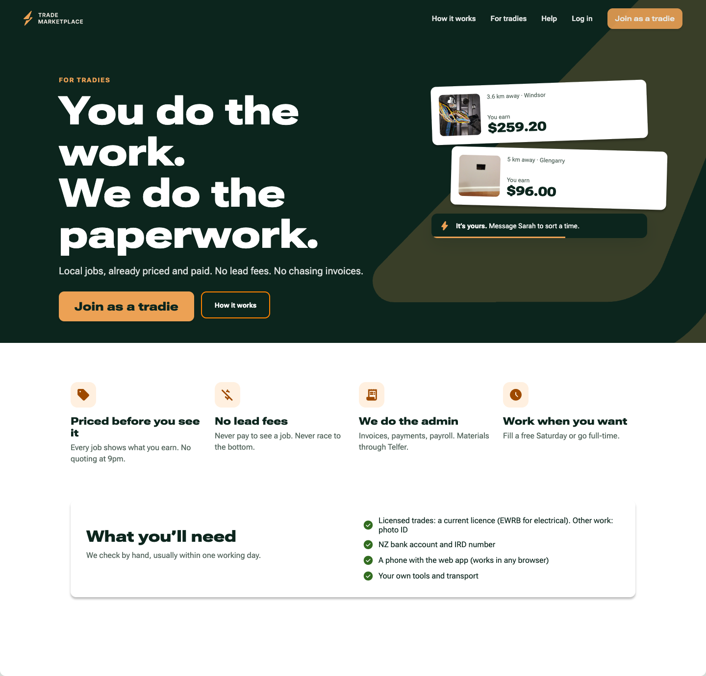
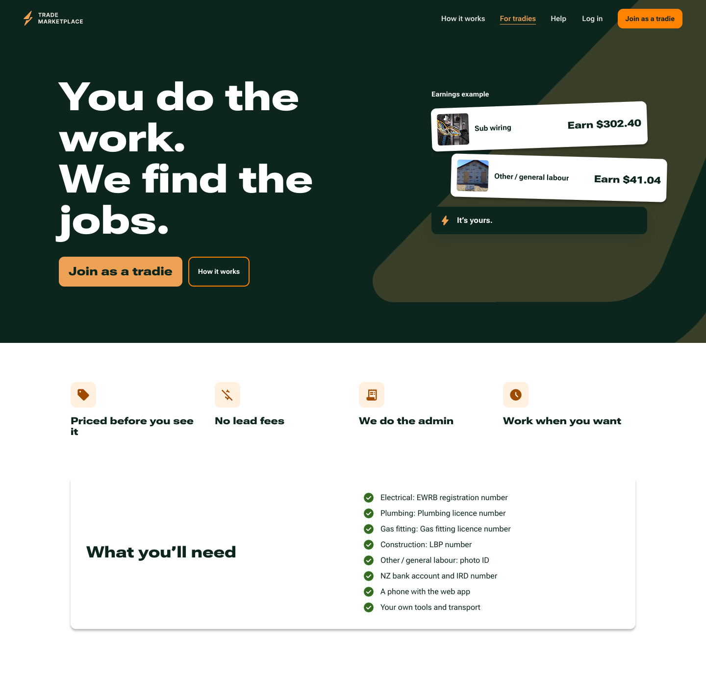
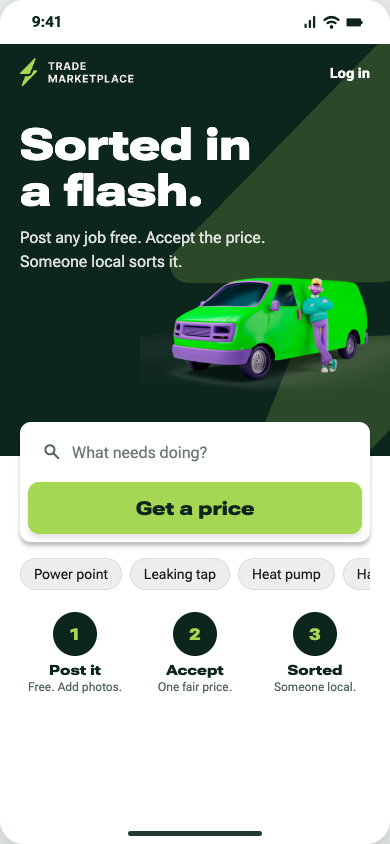
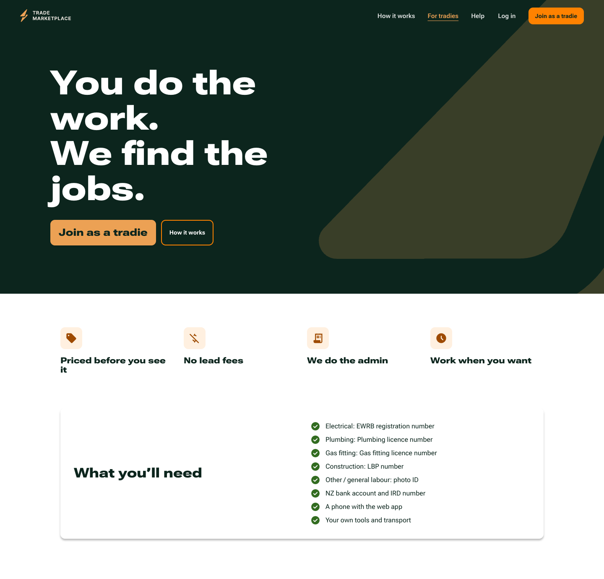
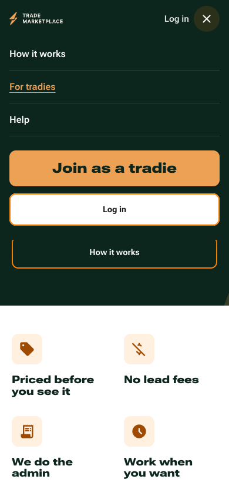
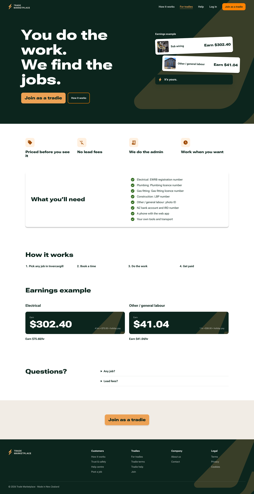
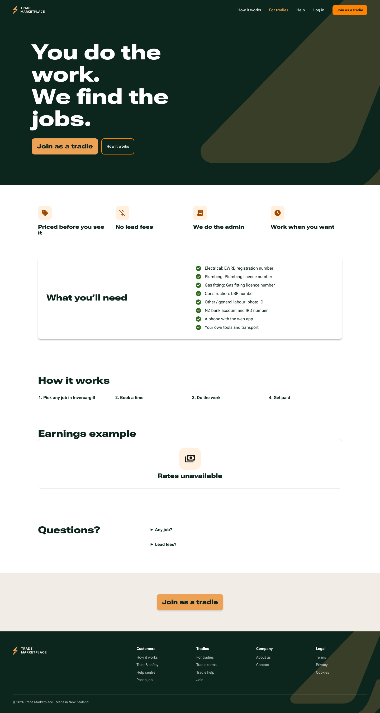
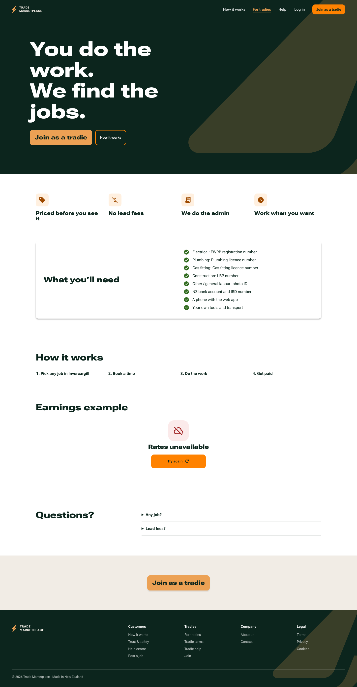
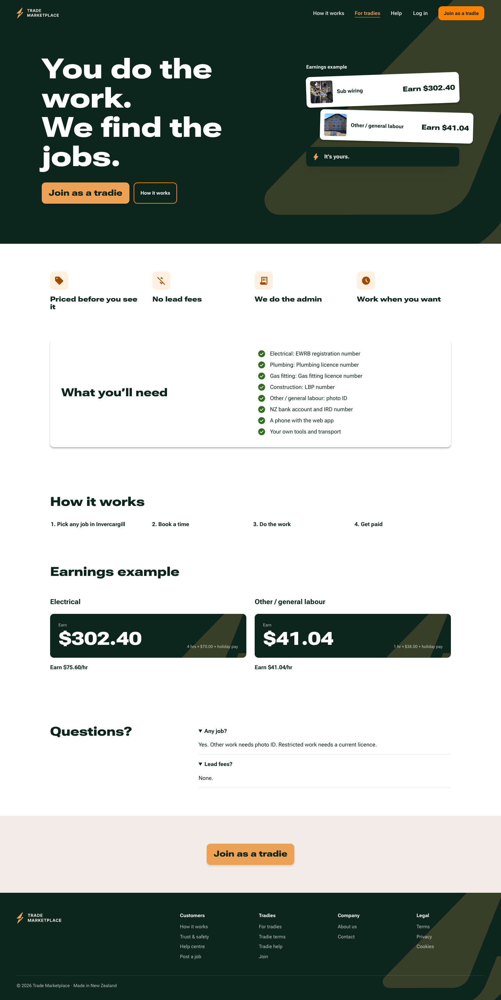
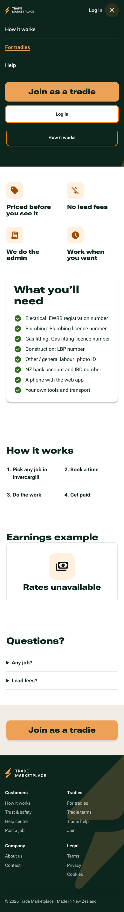

# For tradies · #213

The `/for-tradies` page uses the founder's exact hero, trade colours, existing buttons, job rows, price blocks, feedback, header and footer. Requirements come from `SIGNUP_TRADES`. Earnings examples come from current server settings through `ratesForTrade`, `priceWork` and `perHour`; only worker pay reaches the client. Missing or invalid settings never fall back to mockup amounts. The existing Open Graph and Twitter routes are unchanged. No testimonials or #280 onboarding rules are invented.

All required gates pass on application/test source commit `49934c3`, rebased onto main `faaf5d2`. This review records the final production-build captures; subsequent changes only update screenshots, counts and this check report. See [exact results](checks.md).

## References and visual review

Opened the real Chromium references before implementation. Desktop: `docs/design/pages.html#w-fortradies`. There is no For tradies frame in `screens.html`; the closest phone reference is its public landing frame. The desktop reference still contains the superseded hero and supporting copy. The implementation follows the newer founder hero, `Earn` labels, New Zealand naming, minimal-text instruction and configured requirements instead.

Two visual correction passes are preserved in the local task workspace’s `verification/` folder: pass 1 identified the inherited heading-size/icon rules; pass 2 corrected those and checked the phone composition. Browser verification then found and corrected the missing shared header-height variable, which caused M06 nav fill at the top. The final captures below are from the production build, with fonts loaded and reduced motion.

| Reference at 1440 | Built at 1440 |
|---|---|
|  |  |

| Closest phone reference at 390 | Built at 390 |
|---|---|
|  |  |

The reference has no designed empty/loading/error/FAQ states or full page below the requirements card. Those use the existing kit and the closest public-page layout. The same-size comparison crops below cover every state; full captures afterward show each distinct earnings/FAQ state below the reference area.

| State / size | Reference | Built comparison |
|---|---|---|
| empty / 1440 |  |  |
| empty / 390 |  |  |
| loading / 1440 |  |  |
| loading / 390 |  |  |
| error / 1440 |  |  |
| error / 390 |  |  |
| faq-open / 1440 |  |  |
| faq-open / 390 |  |  |
| Menu / 390 |  |  |

Full captures:

| State | Desktop 1440 | Phone 390 |
|---|---|---|
| Ready, isolated settings |  |  |
| Empty settings |  |  |
| Loading |  |  |
| Failed settings read |  |  |
| FAQ expanded |  |  |
| Header menu | Uses desktop navigation |  |

Preview states: `/dev/components/for-tradies?state=ready`, `empty`, `loading`, `error`. They use the existing `guardDevPage` and are unavailable on Vercel. Production-build captures used `SCREENSHOT_DEV_PAGES=1` locally. Public `/for-tradies` reads real server settings per request; no public query parameter injects preview prices.

## Component inventory consulted

| Area | Existing kit |
|---|---|
| Buttons and links | `Button`, `IconButton`, `TextLink` |
| Fields | `Field`, `TextFields`, `ChoiceFields`, `AddressField`, `TimeWindowPicker` |
| Cards | `JobRow`, `JobTile`, `CategoryTile`, `ProfileCard`, `StatCards`, `EmptyCard` |
| Status | `Pill`, `StatusPill`, `BountyPill`, `PriceBlock`, `Tracker` |
| Overlays | `Dialog`, `Drawer`, `Sheet`, `Menu`, `Toast`, `Banner` |
| Feedback | `Skeleton`, `LoadingRegion`, `EmptyState`, `ErrorState`, `LiveMessage`, `OfflineBanner`, `Progress` |
| Data | `DataTable`, `QuickFilters`, `FilterBar`, `Tabs`, `Pagination` |
| Media | `Avatar`, `Stars`, `PhotoPicker`, `PhotoGallery`, `PhotoViewer`, `DropZone`, `ProgressRing` |
| Map | `MapSurface`, `MapboxSurface`, `MapListLayout`, `MapCard`, `MapPin` |
| Shells and foundations | `SiteHeader`, `SiteFooter`, `SiteShell`, app/office shells, `FocusVisibility`, `BoltMark`, `Wordmark`, `Icon`, `src/styles/tokens.css`, named `motion.css` |

There are no `.agents` skills or nested `AGENTS.md` files in this checkout. Read root `AGENTS.md` in full, `DECISIONS.md`, `WEBAPP_SPEC.md`, the relevant front-end guide, issue/comments, and the site-shell/testing guidance. The latest direct minimal-text instruction overrides older supporting-copy guidance for this new page.

## Words

Counts are browser-visible text tokens in the complete page, including visible amounts and excluding decorative Material Symbol ligatures, invisible accessibility text, closed FAQ answers, hidden responsive content and graphical wordmark paths. Covered text behind the open mobile menu is excluded. `main` excludes header/footer; `screen` includes them. Open FAQ answers are counted in their own state. See [the machine-readable counts](word-counts.json).

| State | Main 1440 | Main 390 | Screen 1440 | Screen 390 |
|---|---:|---:|---:|---:|
| Ready | 147 | 133 | 196 | 172 |
| Empty | 108 | 108 | 157 | 147 |
| Loading | 106 | 106 | 155 | 145 |
| Error | 110 | 110 | 159 | 149 |
| FAQ expanded | 160 | 146 | 209 | 185 |
| Menu | — | 96 | — | 147 |

## Verification boundary

Local app ports 3213 and 4213; disposable Postgres container `trade-213-tests` on 127.0.0.1:55413. Supabase and production database variables were empty throughout browser/build checks. Database tests used only that disposable container. No live database, secrets, auth configuration, financial actions, merge or deployment.

The original Node 22.17 runtime hit `Unexpected module status 3` while collecting an unchanged Supabase import in the full e2e suite. An official, checksum-verified Node 22.22 runtime in `/tmp/trade-213-node` was used for the rerun; both satisfy the declared Node 22 engine range. No repository dependency or engine requirement was changed.

Final results are recorded in [checks.md](checks.md). No required local gate remains blocked.

Made by: Codex (GPT-6.1).
